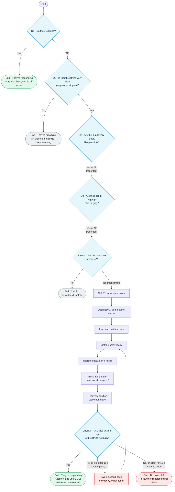

# Naloxone protocol: question flowchart

Every question the app asks, and where each answer leads. Built from [`src/protocols/naloxone.json`](src/protocols/naloxone.json). If you change a branch there, update this file too.

Diamonds are questions, rectangles are instructions (the user says "next"), and rounded boxes are endings. Every ending shows the EMS handoff log.

## The questions

| # | Step id | Question on screen | Yes → | No → |
|---|---|---|---|---|
| Q1 | `q-responds` | Shout their name, shake their shoulders, and firmly rub the middle of their chest. **Do they respond?** | End: *They're responding* | Q2 |
| Q2 | `q-breathing` | Watch their chest for up to 10 seconds. **Is their breathing very slow, gasping, or stopped?** | Q3 | End: *They're breathing* |
| Q3 | `q-pupils` | **Are the pupils very small, like pinpoints?** | Q4 | Q4 |
| Q4 | `q-lips` | **Are their lips or fingertips blue or gray?** | Result | Result |
| Result | `result` | **Use the naloxone in your kit?** (wording below) | Naloxone steps | End: *Call 911* |
| Check-in | `checkin` | **Are they waking up or breathing normally?** | End: *They're responding* | Second dose. After 2 doses: End: *No doses left* |

## Rules that aren't obvious from the diagram

- **Q3 and Q4 don't branch.** The app logs both answers, and they change what the Result screen says:
  - If either is Yes, it says *"This looks like a possible opioid overdose. Use the naloxone in your kit?"*
  - If both are No, it says *"An overdose is possible. Naloxone won't harm someone who hasn't taken opioids. Use the naloxone in your kit?"*
- **Silence counts as No at the check-in.** After 15 seconds with no answer (10 s with `?demo=1`), the app logs "no answer, counted as not responding" and moves on as if the answer was No.
- **The second dose goes back through the same steps with new wording:**
  - "Get the spray ready" becomes "Get a new spray ready".
  - "Insert the nozzle" becomes "Use the other nostril".
- **The kit holds 2 doses** (`maxDoses`). After the second dose, a No at the check-in ends at *No doses left* instead of starting a third dose.
- **Timer lengths:** the recovery countdown is 2:30, or 15 s with `?demo=1`.
- **Back:** the user can go back from questions and instructions. Going back is blocked during the countdown and the check-in, and once a dose is given (a dose can't be undone).
- **Button colors:** Yes and No look the same on every question except Result. There, Yes is highlighted because the guidance favors giving naloxone. This is set by `"recommended": "yes"` in the protocol file.
